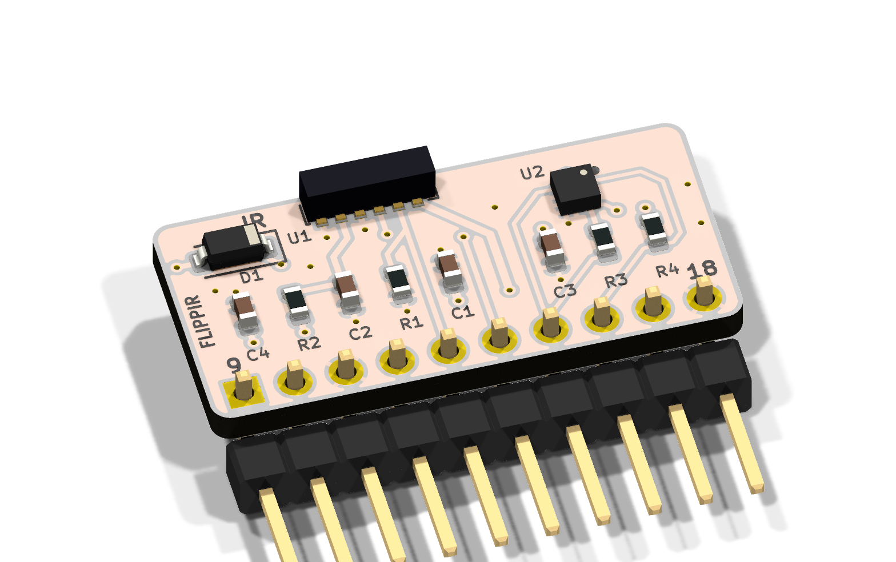
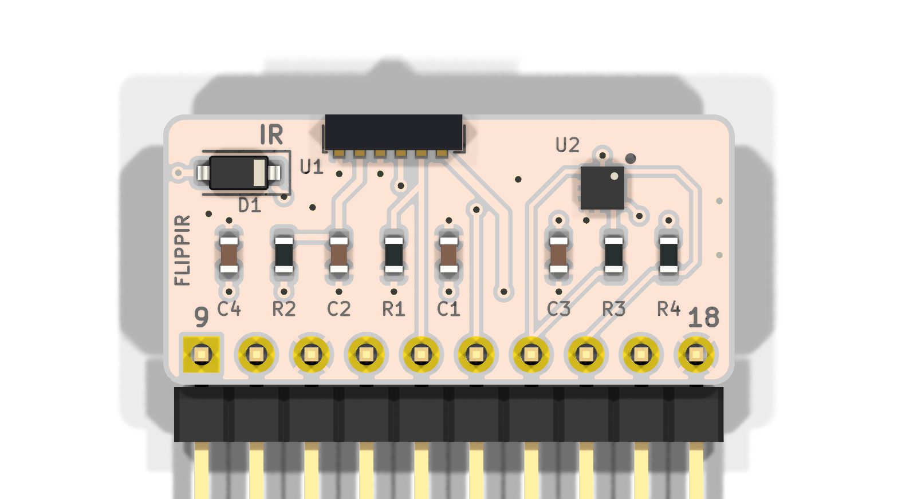
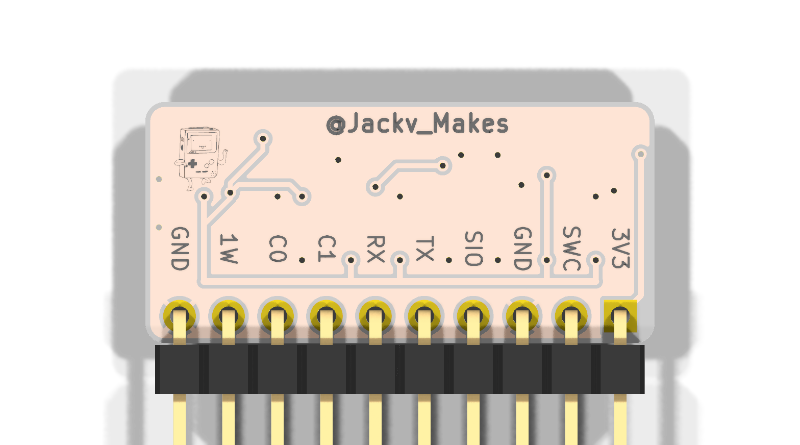
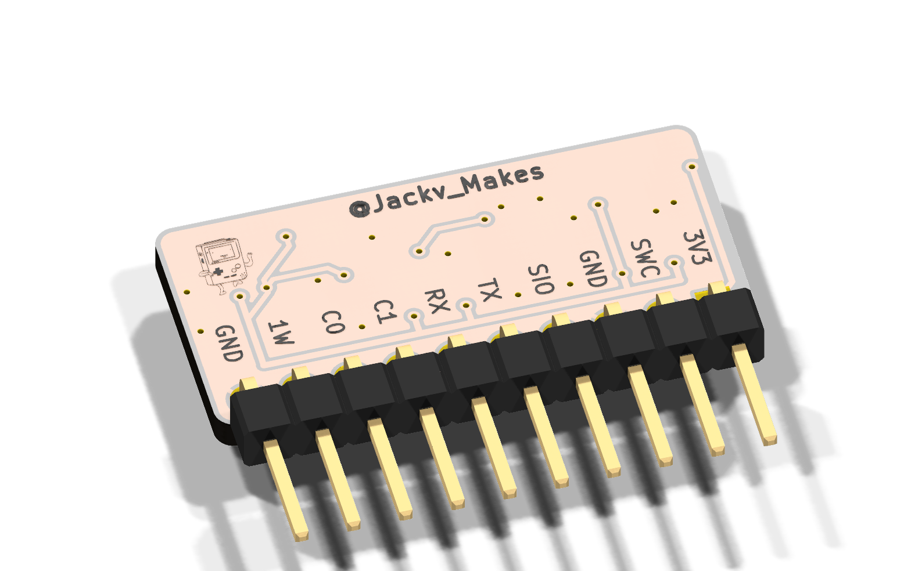

# FlippIR

FlippIR is a small add-on board for the Flipper Zero that gives it an IrDA
transceiver and an accelerometer on the GPIO header. I made it so my Flipper
could talk to Game Boy and DS games over infrared the way those consoles
actually do it, which the Flipper's own IR port can't.

The Flipper's built-in IR is a remote-control port: the receiver is a 38 kHz
demodulator and only sees carrier bursts. The Game Boy Color's IR port and the
Pokéwalker/DS IrDA link both use plain, unmodulated light with microsecond
timing, so the built-in port never hears them. The STM32 inside the Flipper has
an IrDA encoder/decoder built into USART1, though, and that USART is on GPIO
pins 13 and 14. FlippIR puts a Vishay TFBS4711 transceiver right on those pins,
so the Flipper gets a real IrDA port, and an ST LIS2DE12 accelerometer on the
I2C pins next to them for step counting. A Schottky diode in the supply makes
plugging it in backwards harmless.

It is 26.4 × 12.5 mm, two layers, all 0603 passives, and stands upright on
pins 9–18. I have JLCPCB assemble the top side and solder the header myself.

## What runs on it

Two apps I've written for the Flipper use this board:

- **[Flipwalker](https://github.com/Jackv-makes/Flipwalker)** turns the Flipper
  into a Pokéwalker. It runs lumirth's reconstruction of the real Pokéwalker
  firmware (via Stickwalker), so the game is the real one: steps, Watts, Poké
  Radar, dowsing, and the IR link to HeartGold/SoulSilver. FlippIR provides the
  IrDA link and the step counter. Verified with HeartGold/SoulSilver in both
  directions: a Pokémon out for a stroll and back again.
- **[FlipGift](https://github.com/Jackv-makes/FlipGift)**
  sends a Gen II Mystery Gift (Gold, Silver, Crystal) to a real Game Boy Color
  cartridge, the way two Game Boys would. The Game Boy's IR isn't IrDA, so the
  app bit-bangs the transceiver instead of using the USART. Verified with a
  retail US Pokémon Gold cart: items, decorations, and reading back the trainer
  data the cart sends in return. The accelerometer isn't used.

Both apps run on this board unchanged, in any revision from v0.6 up.

## What else it could do

None of this is built or tested, it's what the hardware makes possible:

- **Other Game Boy Color IR games.** Pokémon Trading Card Game 2, Super Mario
  Bros. Deluxe, Mission: Impossible, Perfect Dark, Robopon and a handful of
  others use the same raw IR port as Gen II Pokémon. The Mystery Gift app shows
  the transceiver can be driven that way (marks as chains of 20 µs pulses,
  receive by edge timing); each game's protocol would still need working out.
- **A real IrDA port.** USART1's IrDA mode does SIR at up to 115.2 kbit/s, which
  is what old PDAs, phones, printers and laptops speak. Raw frames are easy; a
  proper IrLAP/IrLMP/OBEX stack would be a project of its own.
- **Talking to a real Pokéwalker.** Flipwalker plays the walker's side of the
  link. The DS side of the protocol is documented too, so the board could stand
  in for the game and read or write a real walker.
- **Motion for other apps.** The LIS2DE12 is a plain I2C accelerometer at 0x19:
  pedometer, tilt control, tap detection, orientation.

What it is not for: 38 kHz remote control, where the Flipper's own IR is better,
and anything that needs long marks from the transmitter. The TFBS4711 clamps a
drive pulse of 23 µs or more to an unpredictable length and shuts the LED off
past 100 µs, so long marks have to be sent as pulse chains. Range is a few
centimetres against a Game Boy's weak LED and more against an IrDA device.

## The board

| Part | What | Flipper pins |
| --- | --- | --- |
| U1 Vishay TFBS4711-TR1 | IrDA transceiver, side view, facing away from the Flipper | 13 (USART1 TX, PB6), 14 (USART1 RX, PB7) |
| U2 ST LIS2DE12 | Accelerometer, I2C address 0x19 (LIS2DH12 also fits) | 15 (SDA, PC1), 16 (SCL, PC0) |
| D1 MBR0520 | Schottky diode in the 3.3 V feed, reverse-plug protection | 9 (3.3 V) |
| J1 | 10-pin right-angle 2.54 mm header | 9–18 |

The IRED anode goes straight to 3.3 V, which is what Vishay asks for (the chip
regulates its own 300 mA pulses). R2 and C2 filter the receiver supply, C1
buffers the LED supply, R1 holds TX low when no app is driving it, R3/R4 are
the I2C pull-ups.

**Don't need the accelerometer?** The same board works with the LIS2DE12, its
decoupling capacitor and the two I2C pull-ups left off. The IR side doesn't
touch them; pins 15 and 16 just stay unconnected.

It plugs into the Flipper's 10-pin socket (pins 9–18) with the pad marked
**9 / 3V3** on the socket pin next to the gap between the 8-pin and 10-pin
sockets. It fits either way round; D1 makes the wrong way harmless, the board
just doesn't power up.

### Hand wiring instead

The same parts on breakouts work just as well. For the transceiver (TFBS4711,
or TFDU4101):

| TFBS4711 pin | Flipper pin |
| --- | --- |
| 1 VCC2 (IR LED anode) | 9 (3.3 V) |
| 2 TXD | 13 |
| 3 RXD | 14 |
| 4 SD (shutdown) | GND |
| 5 VCC1 | 9 (3.3 V) |
| 6 GND | 8, 11 or 18 |

Any I2C accelerometer breakout on pins 15/16 does for Flipwalker (LIS3DH,
LIS2DH12, MPU-6050/6500/9250 and ADXL345 are all detected). A bare IR LED and
photodiode won't do: pin 14 feeds the USART's IrDA decoder through a 40 kΩ
pull-up and a bare photodiode can't drive it at any useful distance.

## Credits

- [lumirth](https://github.com/lumirth/stickwalker) for Stickwalker and the
  Pokéwalker firmware reconstruction that Flipwalker runs. Stickwalker's own
  bare-photodiode receiver is what convinced me a proper transceiver was the
  way to go on the Flipper.
- [TheRealNox](https://github.com/TheRealNox/flipper-pokemon-mystery-gift) for
  the Gen II Mystery Gift protocol work the Pokemon Mystery Gift app started
  from.
- [kbembedded](https://github.com/kbembedded/Flipper-Zero-Game-Boy-Pokemon-Trading)
  for spelling out why the Flipper's onboard IR can't talk to a Game Boy.
- Vishay's TFBS4711 datasheet for the reference circuit.
